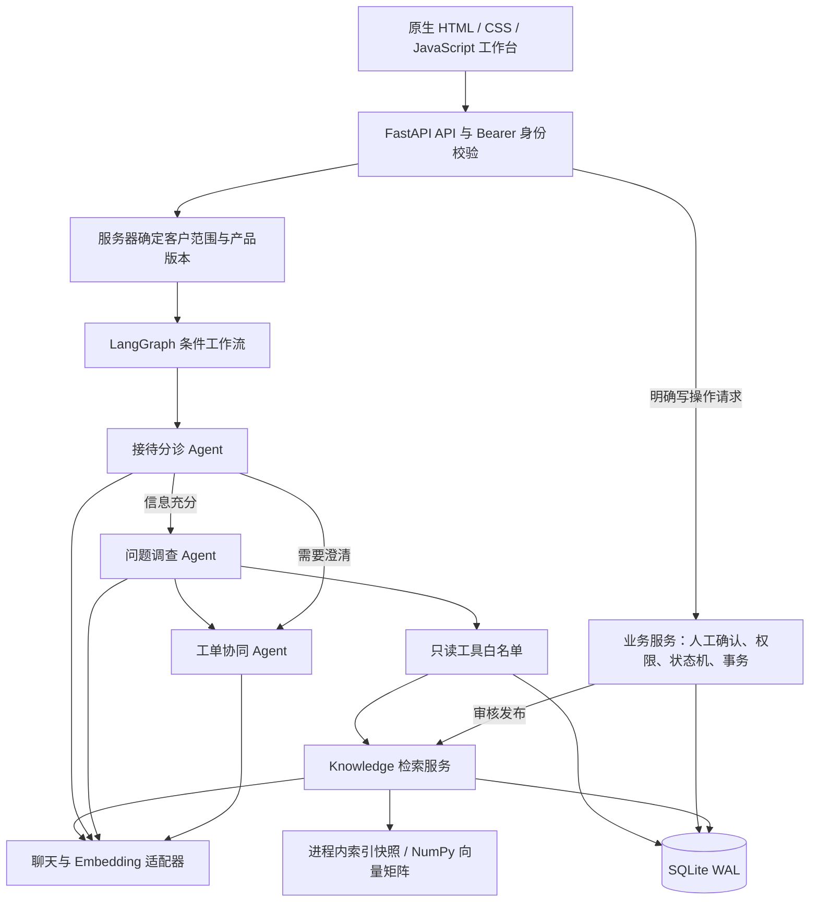
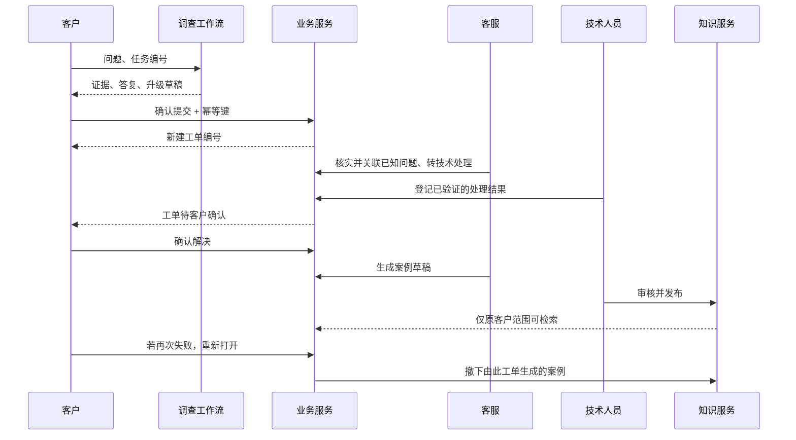

# 整体架构与具体链路

## 1. 项目到底解决什么

软件售后人员收到“订单导入失败”后，往往要分开查产品版本、任务记录、帮助文档和历史工单。ResolveDesk 把这个调查过程放到同一个工作台，产出可检查的答复或升级草稿，再通过工单流转把事情处理完。

项目以自建虚构的「商舟订单云」为例，只覆盖导入、导出、权限三个模块。产品运行数据当前位于本地 `tasks` 表；工具接口是真实执行的数据库查询，但表里的数据是演示夹具。它没有连接真实商家系统。

## 2. 整体架构



这是一套单进程模块化应用。选择 SQLite、精确向量扫描、原生前端，是为了让核心链路足够清楚、便于独立实现。这里没有消息队列、Redis、向量数据库或微服务依赖。

聊天模型和向量模型分别配置。demo 模式使用规则与词法哈希替换模型调用，界面、日志和报告明确标识；live 模式使用真正的 HTTP API。

## 3. 数据模型

| 表 | 业务含义 | 关键约束 |
|---|---|---|
| `customers` | 客户与当前使用环境 | 版本由服务器查询 |
| `tasks` | 模拟产品运行任务 | 查询同时带任务 ID 和客户 ID |
| `documents` | 已发布产品文档与客户案例 | `customer_id=NULL` 为共享文档，其余只属于指定客户 |
| `chunks` | 文本片段与归一化向量 | 片段属于文档，文档删除时级联删除 |
| `runs` | 一次 Agent 调查 | running/completed/failed，保存最终结果、事件与耗时 |
| `tickets` | 客户工单 | `run_id UNIQUE`、修订号、问题关联、证据快照 |
| `ticket_events` | 处理历史 | 操作者、状态、说明、时间 |
| `problems` | 可关联多个客户工单的共享产品问题 | 模块与版本匹配、修订号 |
| `knowledge_drafts` | 从已解决工单生成的待审案例 | 一个工单一个草稿、保留原客户范围 |
| `idempotency` | 客户端重复提交记录 | `(actor,key)` 唯一，并绑定具体操作 |
| `metadata` | 知识索引修订号 | 事务内递增，供进程缓存检查 |

共享产品问题只存通用故障信息；客户工单和调查结果保持客户隔离。自动生成的案例不会直接变为所有客户可见的共享知识。

## 4. 从提问到答复

以 `IMP-1001 / E2013` 为例。

1. 浏览器提交 `POST /api/ask`，携带访问凭证、问题、检索策略；继续调查时可携带工单编号。
2. `auth.py` 将凭证映射为服务器身份。客户不能通过请求体切换到其他客户；客服可选一个明确客户范围。
3. `main.py` 查询真实的客户环境。v2.0 来自数据库，不相信用户说“我是 v1.0”，也不相信模型返回的版本。
4. 检查进程内活动调查数，小于 8 才准入；插入 `running` 运行记录。
5. 分诊 Agent 输出经 Pydantic 验证的意图、模块、任务编号或澄清问题。如果任务存在且属于当前客户，以任务模块校正分诊结果。
6. 信息不足走澄清分支；否则进入调查节点。
7. 调查节点并行进行初始知识检索、当前客户最近相关工单查询、同模块同版本的已知问题查询。有任务编号时，再执行绑定客户范围的任务查询。
8. live 模式下调查 Agent 读取这些初步证据，通过 Function Calling 决定是否补充查询或换一种问法重新检索。额外工具最多 3 轮、8 次调用，每轮最多 4 个；模型调用的额外工具在当前实现中顺序执行。demo 模式直接整理规则式调查结果。
9. 协同 Agent 根据调查结果输出 `answer / clarify / escalate`、答复、引用 ID 和升级草稿。不存在的引用会导致原答复被拦截并建议人工核查；没有知识和可访问任务证据时，不允许直接生成确定性解决答复。
10. 最终结果、事件和耗时保存到 `runs`。浏览器显示引用、工具事实与执行轨迹。**至此没有创建工单或执行修复。**

分诊只负责路由，调查只负责读证据，协同只负责结构化答复与建议。这是职责与上下文的拆分，不是让三个模型互相聊天。当前两个后续角色在单次调查内串行，不宣称自主群体协商。

## 5. RAG 入库和查询

### 入库

```text
Markdown / 纯文本
→ 按标题与段落组块
→ 长段落按 650 字符切分、80 字符重叠
→ 用“标题 + 片段”生成向量并归一化
→ 一个事务写入文档、片段、模型指纹
→ 同事务递增 index_revision
```

网络向量请求发生在数据库事务外。向量失败时，没有半篇文档被发布；审核草稿在索引计算期间被编辑或工单重新打开时，最终事务会再次检查并拒绝旧结果。

标题不一定复制到每个片段的正文，但参与了分词与向量生成。650/80 是当前字符级工程参数，**不是按 token 精确计数**，也不是经实验证明的最优值。

### 查询

```text
查询问题
→ 先按客户、产品版本、模块筛选候选片段
→ BM25 词法排名 / 归一化向量余弦排名
→ 各分支最多取 30 个候选
→ RRF 融合，取 Top-K
→ 把片段、适用版本和来源 ID 交给模型
```

文档版本必须为当前版本或 `all`；指定业务模块时，同时允许该模块与 general 文档。私有案例只能属于当前客户。过滤在候选排名之前执行。

索引快照由不可变读取引用构成：修订号变化时，从同一个数据库读事务取得一致的片段和版本，构建新的向量矩阵与词频计数，然后整体替换；一次排名保留其取得的快照引用。模型指纹变化在启动时触发重建。

查询向量有最多 128 条的进程内 LRU 缓存；缓存只存与客户无关的查询向量，不缓存客户检索结果。它不是答案缓存。向量为精确扫描，复杂度随候选片段数和维度增长。

## 6. 从升级到客户确认



建单幂等有两层：`(actor,key)` 防止同一次提交重复执行；`tickets.run_id UNIQUE` 防止同一调查换幂等键重复建单。同一键被用于其他调查返回 409。

更新工单必须携带 `expected_revision`。数据库短事务读取修订号，校验角色允许的状态，再执行更新并追加事件。第二个持有旧修订号的请求返回 409，避免后提交者覆盖他人的处理。

技术人员把共享问题标记为 fixed 时，只将关联且处于 in_progress/waiting_engineering 的工单推进为 pending_confirmation；客户确认后才能 resolved。等待客户补充的工单不会被批量越过。

## 7. 失败与恢复

| 情况 | 行为 |
|---|---|
| 超过活动调查上限 | 429 + Retry-After，不启动新运行 |
| 单个上游请求超时 | 明确的工具失败或模型 502，无静默演示降级 |
| 整体调查超时 | 504，运行标记 failed，释放准入名额 |
| 模型 JSON 不合法 | 拒绝结构化输出，不执行写入 |
| 模型调用越权工具 | 白名单拒绝，返回工具错误，记录事件 |
| 错误引用 ID | 拦截原答复，建议人工处理 |
| 工单并发修改 | 409，刷新后由人重新决定 |
| 索引服务失败 | 文档不发布，旧索引仍可使用 |
| 工单重开 | 删除其草稿及已发布案例，下一次检索刷新快照 |
| 服务重启时存在 running | 标记 failed，用户可重新发起；没有节点级自动续跑 |

只支持单 worker 运行。多 worker 会让进程内准入各自计数，而且启动时修复运行状态可能相互影响，因此本实现明确不支持直接用多 worker 扩容。

## 8. 对应源码

- 路由和应用生命周期：`app/main.py`
- 编排、提示词、读工具、预算、运行保存：`app/agents.py`
- 文档切分与三种检索：`app/knowledge.py`
- 上游协议与词法特征哈希：`app/providers.py`
- 工单与知识业务不变量：`app/business.py`
- Schema、事务和一致快照：`app/db.py`
- 输入输出模型：`app/models.py`
- 前端操作链路：`web/app.js`
